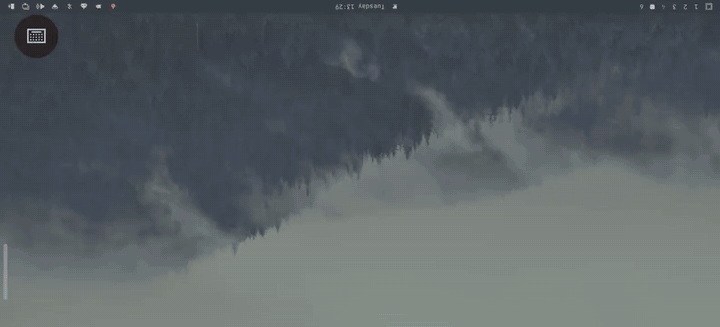

# Hypr Screen

Use your Android phone as an extra **Hyprland** monitor, with **touch** and **keyboard**, a bit like Apple Sidecar.

<p align="center">
  <a href="docs/demo.mp4"></a>
  <br><sub>Phone as a Hyprland monitor: touch, keyboard with Super/Ctrl/Alt row, browsing. <a href="docs/demo.mp4">Full video (MP4)</a></sub>
</p>

Plug the phone in over USB and it becomes a real Hyprland output next to your laptop screen. Drag windows onto it, move workspaces to it, tap and scroll with your fingers, and type with the phone keyboard. Unplug it and the monitor disappears. It also works over Wi-Fi, with no cable needed even for pairing.

## Features

- **Extended display, not a mirror.** Hyprland gets a real (headless) monitor at the phone's native resolution, with its own workspaces and bar.
- **Low-latency video.** Frames are captured with `wf-recorder`, hardware-encoded to H.264 (VAAPI) and hardware-decoded on the phone. Only changed frames are sent, so an idle desktop uses almost no bandwidth.
- **Plug-and-play USB.** A background service notices the phone, opens the app and connects. Nothing to run by hand.
- **Wi-Fi (opt-in).** The app discovers your laptop on the local network. Pair once by tapping **Pair** and accepting on the laptop (like Bluetooth), or just plug in USB once.
- **Secure by default.** Every connection is TLS 1.3 with a pinned certificate, and the phone must prove it holds a pairing key that only ever travels over adb.
- **Multitouch.** A virtual touchscreen is mapped onto the phone's monitor, so you can tap, drag, scroll and pinch.
- **Keyboard.** Type with the phone keyboard. An extra key row gives `Esc Tab Ctrl Alt Super ← ↑ ↓ →`, and the modifiers are sticky, so Super then 1 switches workspace. A Bluetooth keyboard paired to the phone is passed straight through.

## Requirements

**Laptop**
- Hyprland **0.56+**. Both the Lua config (`hyprctl eval`) and the legacy `hyprctl keyword` are supported.
- `wf-recorder`, `android-tools` (adb), `openssl`, Python 3 (standard library only)
- A VAAPI-capable GPU for hardware encoding. Intel is tested; others should work. Set `"encoder": "x264"` for software encoding.
- Write access to `/dev/uinput` for touch and keyboard. Desktop sessions usually get this through logind. Check with `getfacl /dev/uinput`.
- Optional: `wtype`, for typing characters outside the US layout.

**Phone**
- Android 11+ with **USB debugging** enabled (Developer options).

## Install

### 1. Laptop

Install the dependencies (Arch / Omarchy):

```sh
sudo pacman -S --needed wf-recorder android-tools openssl
```

Then install with **mise**:

```sh
mise use -g github:kpanuragh/hypr-screen
hypr-screen --install-service
```

Or from a git checkout:

```sh
git clone https://github.com/kpanuragh/hypr-screen
cd hypr-screen/host
./install.sh
```

Either way, this starts the `hypr-screen` systemd user service, which comes up with your graphical session. Run `hypr-screen --uninstall-service` to remove it.

### 2. Phone

Install the app in one of these ways:

- **Obtainium:** add `https://github.com/kpanuragh/hypr-screen` to get the APK from each new release, with updates.
- **F-Droid / IzzyOnDroid:** coming soon.
- **Direct download:** `hypr-screen-*.apk` from [Releases](../../releases), or `adb install hypr-screen-*.apk`.
- **Build it yourself** (see below).

Release APKs are signed with this certificate (SHA-256):
`bd:84:9d:c5:43:25:28:a0:1d:9d:bb:c4:3b:1d:06:d1:06:40:6e:8c:27:f5:0c:4c:66:1a:8d:4e:83:3a:6d:e1`

### 3. Connect

- **USB:** plug the phone in and accept the USB debugging prompt. The app opens and the phone becomes the monitor to the right of your screen.
- **Wi-Fi:** off by default. Set `"wifi": true` in the config and restart the service. If you use `ufw`, allow only your local network, for example:
  ```sh
  sudo ufw allow from 192.168.1.0/24 to any port 7878
  ```
  Open the app on the same network and tap **Pair** next to your laptop. The phone shows a 6-digit code and a window opens on the laptop: type the code there, press **Enter**, then tap **Confirm** on the phone. After that, tap **Connect** whenever you want the extra monitor.

  Manage Wi-Fi-paired phones with `hypr-screen --devices` and `hypr-screen --forget <id>` (a phone that is connected at that moment stays connected until it disconnects).

On the phone, the **⌨** button opens the keyboard (drag it to move it). **Back** closes the keyboard; pressing Back again disconnects.

## Configuration

`~/.config/hypr-screen/config.json` is created on first run:

| Key | Default | Meaning |
|---|---|---|
| `scale` | `1.5` | Hyprland scale for the phone output |
| `position` | `"auto-right"` | Monitor position (`auto-left`, `0x1080`, …) |
| `fps` | `60` | Refresh rate of the virtual monitor |
| `qp` | `24` | Quality: lower is sharper and uses more bandwidth |
| `encoder` | `"vaapi"` | `vaapi` or `x264` |
| `device` | `"/dev/dri/renderD128"` | VAAPI render node |
| `auto_usb` | `true` | Connect automatically when a phone is plugged in |
| `wifi` | `false` | Also listen on the network (Wi-Fi mode) |
| `wifi_pairing` | `true` | Allow pairing requests over Wi-Fi (they still need your approval) |

Restart after editing: `systemctl --user restart hypr-screen`. Logs: `journalctl --user -u hypr-screen -f`.

## How it works

```
Hyprland ── headless output "HYPRSCREEN" ── wf-recorder (H.264/VAAPI, FLV)
                                                   │
                                hypr-screen service (Python)
                      FLV → framed H.264 ──────────┼──────────► phone: MediaCodec → SurfaceView
          uinput touchscreen + keyboard ◄──────────┴────────── phone: touch / key events
                                         TCP 7878 (adb reverse over USB, or Wi-Fi)
```

- **USB** uses `adb reverse`, so the phone connects to `127.0.0.1:7878` and the traffic never touches the network.
- **Wi-Fi** discovery is a UDP broadcast on port 7878.

### Security

- **USB pairing.** When a phone is plugged in, the service uses adb to write a pairing record (host id, secret key, certificate fingerprint) into the app's private storage (`Android/data/com.hyprscreen`), which other apps can't read.
- **Wi-Fi pairing.** Works like Bluetooth pairing. The phone shows a 6-digit code computed from the laptop's certificate fingerprint and a random value from each side. The phone commits to its value before it sees the laptop's, so a man in the middle can't make the code match. You type the code on the laptop (a stray keypress can't accept a request). The laptop sends a new per-phone secret only after you accept on **both** the laptop and the phone. Requests are refused while Wi-Fi pairing is off, only one can be open at a time, and a rejected request blocks new ones for 10 seconds.
- **Encryption.** Every connection, USB included, is **TLS 1.3**. The phone pins the laptop's self-signed certificate, so a fake laptop on the network can't impersonate yours, and video and keystrokes can't be read or altered in transit.
- **Authentication.** After TLS, the phone answers a fresh challenge with `HMAC-SHA256(secret, server_nonce | client_nonce)`. Unpaired connections are rejected, including other local processes on the laptop and other apps on the phone.
- **Input safety.** Power, sleep, suspend and SysRq keys can never be sent from the phone.
- **Files.** Keys live in `~/.config/hypr-screen/` (`identity.json`, `key.pem`, mode 600). Wi-Fi-paired phones are in `devices.json`; remove one with `hypr-screen --forget <id>`. Delete the files and restart the service to revoke every paired phone. The app disables Android backups of its pairing data.

## Build from source

```sh
cd android
./gradlew assembleDebug          # app/build/outputs/apk/debug/app-debug.apk
```

This needs JDK 17+ and the Android SDK (platform 36), with the SDK path in `ANDROID_HOME` or `local.properties`.

## Limitations

- Only one phone at a time.
- While the phone keyboard is open, it covers part of the picture.
- Characters outside the US layout are typed through `wtype`, one at a time.
- No audio. Audio keeps playing on the laptop.
- Tested on: Omarchy, Hyprland 0.56, Intel Iris Xe, OnePlus (Android 17). Reports from other setups are welcome.

## License

MIT
